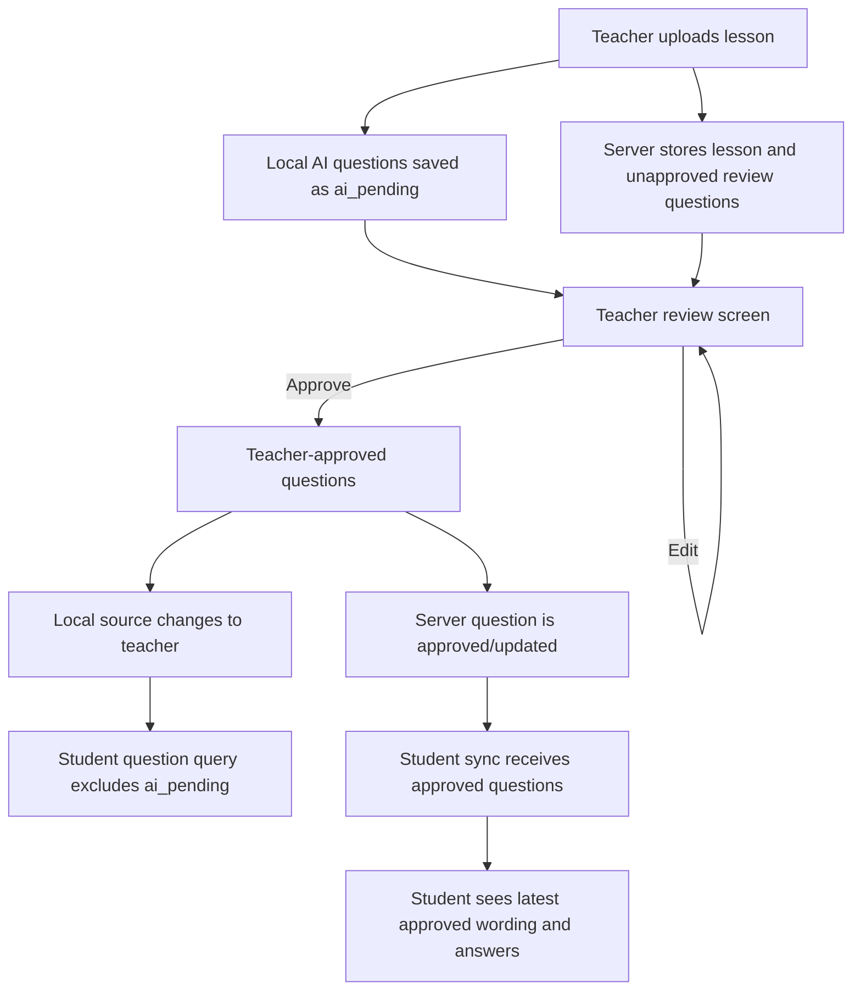

# Question approval flow

The server-approved question set is the only question set students should
receive. This is true when teacher and student use different devices and when
they share one device.

## Shared-device identity boundary

The student hub does not use the unrestricted local subject list. It first
requires an active student class link, then lists only subjects that contain
at least one approved local question (`teacher`) or synchronized server
question (`cloud`). This prevents a student who takes over a teacher's phone
from seeing the teacher's locally created subjects before joining a class.
The **Join class** action remains available when the filtered list is empty.

If a teacher's online upload fails, the lesson and its questions remain
available in the teacher's local review screen as `ai_pending`. The app
reports that it was saved locally but not shared online; students cannot see
that content until the teacher approves it and the online sharing succeeds.

## Shared-device rule

The local question table uses `source: ai_pending` for generated questions
that have not been approved. Student-facing queries exclude that source.
Teachers use the review query, which includes pending questions, and must
press **Approve** before those questions become visible to a student on the
same device.

Editing a pending question does not approve it. The teacher must still approve
it after checking the wording, options, correct answer, and explanation.

## Cross-device rule

The online review screen saves edits and approval to the backend. Student
content is synchronized from approved backend content, not from the teacher's
unapproved local cache. If synchronization fails, the app must not convert a
pending question into a student-visible question.
